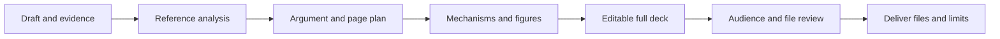

<p align="center"></p>
<h1 align="center">Research PPT SOP</h1>
<p align="center">A reference-driven agent skill for editable research presentations.</p>
<p align="center"><a href="README.zh-CN.md">简体中文</a> · <a href="SKILL.md">Skill instructions</a> · <a href="references/migration.md">Platform setup</a> · <a href="LICENSE">MIT license</a></p>


## What it does

Turn a source draft, figures and a reference deck into a coherent research presentation. The workflow keeps scientific claims tied to evidence, explains mechanisms through actual computation, and separates editable slide text from graphical layers.

- **Reference-driven design:** learn hierarchy, emphasis, semantic arrows and reading paths, not just a color palette.
- **Evidence-aware slides:** distinguish available figures, material needing verification and research that has not been done.
- **Mechanisms explained:** inputs, outputs, internal computation, training/inference and direct comparisons.
- **Complete deliverables:** cover, contents, body, backup slides, speaker notes and page/navigation updates.
- **Audience-facing writing:** remove production chatter while preserving citations, conditions, uncertainty and negative results.
- **Layered checks:** package structure, scientific content, design previews and actual Office behavior remain separate.

The core operating guides and templates are currently written in Simplified Chinese. Python/Node helpers are language-independent.

## Workflow



## Quick start

1. Download this repository or the `.skill` package from [Releases](https://github.com/Scared11a/research-ppt-sop/releases).
2. Load the complete skill directory using your host's supported installation route below.
3. Provide your draft, evidence, reference deck and permitted output location. Invoke the skill:

> Use research-ppt-sop to create a complete, editable research presentation from these materials. Preserve the reference's visual language, explain the mechanisms, and review every audience-facing text surface.

The input templates are in [assets/](assets/). Missing information is kept explicit; the skill does not invent research results or authorize new experiments.

### Choose your host

| Host | Entry point | Important boundary |
|---|---|---|
| **Hana** | Import the `.skill` through the supported skill installer and confirm it; [Hana adapter](references/platforms/hana.md) | ResourceIO, SessionFile and `stage_files` are Hana-specific. |
| **DeepSeek Harness / DSHana** | Put the full directory in a skill root supported by the effective profile, or explicitly pass the rules in a delegated task; [DSH adapter](references/platforms/dsh.md) | Default DSHana delegated presets lack shell and automatic skill discovery. |
| **Codex** | Use a supported `.agents/skills/research-ppt-sop` location and invoke `$research-ppt-sop`; [Codex adapter](references/platforms/codex.md) | Installation does not provide Office rendering, fonts or Hana tools. |

All hosts use the same core workflow. Adapters map capabilities; they do not grant permissions. Cross-platform PPT production has **not** been end-to-end verified.

## Dependencies and safe checks

- Python **3.10+** for the helper scripts. PPTX inventory/relationship audits use the standard library.
- `pdfplumber` and PDFium for optional PDF measurement/previews.
- Node.js and **PptxGenJS** in an explicitly selected Node project for scene generation. The existing workflow used PptxGenJS **4.0.1**.
- Fonts and document/rendering tools supplied by your environment. The bundled font registry probe is macOS-only.

Nothing is installed automatically. The skill does not bundle fonts, model weights, an Office renderer or `node_modules`.

```bash
SKILL_DIR="/absolute/path/to/research-ppt-sop"
NODE_PROJECT="/absolute/path/to/existing-node-project"
python3 "$SKILL_DIR/scripts/preflight.py" --node-project "$NODE_PROJECT"
python3 "$SKILL_DIR/scripts/audit_pptx.py" /absolute/path/to/existing.pptx
```

A successful preflight only proves the reported dependencies were found. See [tool interfaces](references/tools-and-interfaces.md) before commands that generate a deck.

## Inside the skill

| Area | Purpose |
|---|---|
| [SKILL.md](SKILL.md) | Complete execution entry point |
| [Platform contract](references/platform-contract.md) | Resource, tool, permission and delivery mapping |
| [Cover and navigation](references/cover-and-navigation.md) | Cover hierarchy, actual sections, page ranges and links |
| [Figures and evidence](references/figures-and-evidence.md) | Mechanisms, editable layers and comparison identity |
| [Audience review](references/audience-content.md) | Semantic revision across body, labels, footers and notes |
| [Acceptance and recovery](references/acceptance-and-recovery.md) | Checks, failure diagnosis and stopping rules |
| [MANIFEST.md](MANIFEST.md) | File and template inventory |

## Validation and limits

Run the repository checks without generating a presentation:

```bash
python3 -m unittest discover -s tests -v
node --check scripts/build_deck.mjs
```

The release includes static/package checks and experience from existing local presentation workflows. It does **not** establish universal SVG recovery, native Office equations, visual fidelity, GUI editing or cross-platform generation. A design preview is not a rendering of the final PPTX. See [validation scope](references/provenance-and-validation.md).

No private reference deck, personal session log, unpublished research or scientific data is included. Example cases are generic and are not research findings.

## Contributing

Issues and focused pull requests are welcome. Include the host/version, the failing capability and a minimal non-sensitive example. Do not submit credentials, private decks, unpublished papers or research data. Keep the core workflow and platform adapters separate, and report what was actually tested.

## License and acknowledgments

[MIT](LICENSE). Runtime dependencies retain their own licenses. The icon and banner are original assets provided with this project. Documentation/packaging references and dependency notes are in [THIRD_PARTY_NOTICES.md](THIRD_PARTY_NOTICES.md).
